<div align="center">


# Campuslands AI Academy · Landing Oficial

**Rediseño integral de experiencia web, identidad visual y arquitectura de conversión bajo el Manual de Marca v1.0**

[](#)
[](#sistema-de-identidad-visual-manual-v10)
[](#arquitectura-y-rendimiento)
[](#experiencia-responsive-mobile-first)

<p align="center">
  <em>«No solo hablan de IA: saben enseñarla, aplicarla y llevarla a problemas reales».</em>
</p>

</div>

---

## 1. Propósito del Rediseño

**Campuslands AI Academy** forma a empresas, equipos de trabajo y profesionales independientes en inteligencia artificial aplicada. Esta nueva landing traduce la evolución de la marca a una **experiencia espacial interactiva** donde cada sección funciona como una fase de misión (`T-0 · Cabina` → `08 · Despegue`), manteniendo todos los datos y flujos reales de inscripción, diagnóstico empresarial, validación de certificados y contacto directo con especialistas por WhatsApp.

### Pilares de la propuesta

- **Fidelidad de marca sin rigidez**: aplicación estricta de la nueva paleta (`Black`, `Evox Purple`, `Electric Violet`, `Soft Violet`, `White`, `Muted Gray`), tipografía única (`Poppins`), reglas de logo con zona de protección y uso de **Max** en sus poses y expresiones LED oficiales.
- **Interactividad con propósito de conversión**: cada interacción responde una objeción real del visitante (qué rol tiene, qué herramientas va a dominar, qué plan encaja con su tiempo, cuánto le cuesta esperar y cómo cambia su operación antes y después).
- **Ingeniería ligera y accesible**: cero dependencias pesadas de terceros, activos en `WebP` y `SVG` optimizados, navegación completa por teclado (`:focus-visible`), contraste WCAG 2.1 AA/AAA y respeto automático por `prefers-reduced-motion: reduce`.

---

## 2. Inicio Rápido

El proyecto no requiere pasos de compilación ni instalación de paquetes externos: carga de forma instantánea en cualquier servidor estático.

### Opción A · Con Python (recomendado)

```bash
# Clonar el repositorio
git clone <URL_DEL_REPOSITORIO>
cd lading

# Iniciar servidor local en el puerto 8080
python -m http.server 8080
```

Abre **[http://localhost:8080](http://localhost:8080)** en tu navegador.

### Opción B · Con Node.js (`npx`)

```bash
npx serve .
```

### Opción C · Apertura directa

Haz doble clic sobre `index.html` o ábrelo con la extensión **Live Server** de VS Code.

---

## 3. Sistema de Identidad Visual (Manual v1.0)

### Paleta Oficial y Contraste WCAG 2.1

| Muestra | Nombre | HEX / RGB | Proporción y Rol en la Interfaz | Contraste sobre `#050507` |
| :---: | :--- | :--- | :--- | :---: |
|  | **Black** | `#050507` · `rgb(5, 5, 7)` | **60 %+** · Fondo espacial dominante de toda la experiencia | — |
|  | **White** | `#FFFFFF` · `rgb(255, 255, 255)` | **25 %** · Titulares principales, énfasis y textos sobre botones | **20,4 : 1** (AAA) |
|  | **Evox Purple** | `#7026E8` · `rgb(112, 38, 232)` | Color primario de marca: CTAs, pasos numerados y bloque de cierre | **6,7 : 1** con texto blanco |
|  | **Electric Violet** | `#9636FF` · `rgb(150, 54, 255)` | Halos de luz atmosféricos, gradientes de energía y estados activos | **4,9 : 1** con texto blanco |
|  | **Soft Violet** | `#B783FF` · `rgb(183, 131, 255)` | Etiquetas en píldora, **una sola palabra destacada** por titular y bordes | **7,5 : 1** (AAA) |
|  | **Muted Gray** | `#8E8998` · `rgb(142, 137, 152)` | Metadatos, créditos, pies de sección y etiquetas secundarias | **6,0 : 1** (AA) |
|  | **Body Lilac** | `#DCD6EA` · `rgb(220, 214, 234)` | Tono de apoyo del manual para lectura cómoda en párrafos largos | **14,2 : 1** (AAA) |

### Reglas de Marca Aplicadas

1. **Tipografía única**: familia **Poppins** (`Regular 400`, `Medium 500`, `SemiBold 600`, `Bold 700` y `ExtraBold 800`).
2. **Uso del logo oficial**:
   - **Cabecera oscura**: versión horizontal blanca (`assets/img/logo-horizontal-white.webp`) respetando el ancho mínimo (`≥ 160 px`) y la zona de protección (`x = altura de ACADEMY`).
   - **Cierre / Footer**: versión vertical principal con casco violeta y texto blanco (`assets/img/logo-vertical.webp`, `160 px`).
   - **Riel de misión y favicon**: símbolo oficial del casco (`assets/img/casco-white.webp`, `≥ 32 px`).
3. **Nomenclatura**: corregidas todas las menciones antiguas de *«IA Academy»*. Primera mención como **Campuslands AI Academy**, siguientes como **AI Academy**, y la tecnología siempre como **IA** en frases en español.
4. **Voz y copywriting**: frases cortas en voz activa, tono de *trainer* experto y cercano, mención explícita de herramientas reales (`ChatGPT`, `Claude`, `Gemini`, `n8n`, `Make`, `NotebookLM`) y cero clichés vacíos.

---

## 4. Arquitectura de Conversión e Interactividad

```mermaid
flowchart LR
    A["T-0 · Cabina (Hero Reactivo)"] --> B["01 · Preparación (Beneficios)"]
    B --> C["02 · Constelación (14 Herramientas)"]
    C --> D["03 · Misiones (Recomendador + 5 Planes)"]
    D --> E["04 · Ventana (Calculadora ¿Por qué ahora?)"]
    E --> F["05 · Aterrizaje (Antes / Después 4 Perfiles)"]
    F --> G["06 · Bitácora (Reseñas)"]
    G --> H["07 · Control (FAQs)"]
    H --> I["08 · Despegue (Inscripción + Diagnóstico)"]
```



### Las 4+ Piezas Interactivas

| # | Pieza Interactiva | Qué hace y cómo acerca a la conversión |
| :---: | :--- | :--- |
| **01** | **Hero Reactivo por Perfil + Campo Estelar** | El visitante elige su rol (**Empresa**, **Líder de equipo** o **Independiente**). La cabina cambia en tiempo real la propuesta de valor, los puntos clave, la pose de **Max**, la telemetría del HUD (`Misión` y `Tripulación`), preselecciona su misión recomendada más abajo y sincroniza su caso de uso. Incluye `<canvas>` estelar y parallax suave con el puntero. |
| **02** | **Recorrido Narrativo Ligado al Scroll** | En escritorio, un **riel de misión vertical** muestra el casco de astronauta avanzando entre las etapas `T-0` y `08`. En móvil, una **barra superior de telemetría** indica el progreso del viaje y la etapa activa. Las tarjetas y los altímetros de cada misión se revelan progresivamente con `IntersectionObserver`. |
| **03** | **Calculadora / Recomendador de Misiones** | En 3 preguntas rápidas (*quién se va a formar*, *tiempo disponible* y *objetivo prioritario*), el sistema calcula la trayectoria ideal entre **Ignition (4 h)**, **Booster (8 h)**, **Liftoff (12 h)**, **Odyssey (Personalizado)** y **Nebula (Pregrabado 24/7)**, explicando el porqué y destacando la tarjeta correspondiente. |
| **04** | **Constelación Interactiva de 14 Herramientas** | Mapa estelar con las 14 tecnologías del programa (`ChatGPT`, `Make`, `Gemini`, `Claude`, `Microsoft Copilot`, `GitHub Copilot`, `Midjourney`, `Notion AI`, `Zapier`, `Perplexity`, `NotebookLM`, `Read AI`, `ElevenLabs`, `HeyGen`). Incluye filtros por tarea, líneas de conexión luminosas, ficha técnica en vivo y contador de herramientas exploradas. |
| **05** | **Transformación Antes / Después por Perfil** | Comparador dinámico para **Empresario**, **Director(a) de innovación**, **Profesional independiente** y **Líder de RR. HH.** En escritorio muestra ambos escenarios cara a cara con control deslizante de nivel de adopción; en móvil ofrece una **tarjeta táctil con transformación en un toque (`⚡`) y soporte swipe** sin recortar ni una sola palabra. |
| **06** | **Calculadora «El Costo de Esperar»** | Permite ingresar el número de personas del equipo y las horas semanales en tareas repetitivas para dimensionar las horas anuales que hoy se van en trabajo manual (`personas × horas × 46 semanas`), conectando directo con el **Diagnóstico Empresarial**. |

---

## 5. Experiencia Responsive (Mobile-First)

La interfaz fue diseñada y probada desde **`375 px` de ancho** hasta monitores **`1440 px+`**:

- **Móvil (`375 px – 680 px`)**:
  - Cabecera compacta con menú desplegable accesible (`aria-expanded`, cierre con `Escape` y al seleccionar sección) + barra de progreso de la misión.
  - Constelación transformada automáticamente en **grilla táctil de 2 columnas** con desplazamiento automático hacia la ficha de detalle.
  - Comparador **Antes / Después** en modo tarjeta interactiva con botón de salto instantáneo (`⚡ Ver cómo cambia con AI Academy`) y gestos `swipe` horizontales.
  - **Dock inferior fijo** con acceso directo a **WhatsApp** e **Inscríbete** siempre al alcance del pulgar.
- **Tablet y Portátil (`681 px – 1399 px`)**:
  - Grillas adaptativas de 2 y 3 columnas para Beneficios, Misiones y Reseñas.
  - Tarjetas HUD del Hero alineadas simétricamente bajo Max sin solapamientos.
- **Escritorio Amplio (`1400 px+`)**:
  - Riel lateral de progreso con casco animado, mapa estelar completo con líneas SVG reactivas y comparador dual cara a cara.

---

## 6. Estructura del Proyecto

```text
lading/
├── index.html                  # Documento semántico HTML5 con las 9 secciones del reto
├── README.md                   # Documentación técnica y de diseño
├── css/
│   └── styles.css              # Sistema de diseño (Variables CSS, Manual v1.0, Responsive, Reduced Motion)
├── js/
│   └── main.js                 # Motor interactivo (Hero, Scroll, Constelación, Recomendador, Calculadora, Casos)
└── assets/
    ├── img/                    # Activos oficiales extraídos del manual y optimizados en WebP
    │   ├── logo-vertical.webp
    │   ├── logo-horizontal-white.webp
    │   ├── casco-white.webp
    │   ├── max-presentando.webp
    │   ├── max-aprobando.webp
    │   ├── max-explicando.webp
    │   ├── max-trabajando.webp
    │   ├── max-cafe.webp
    │   ├── max-descansando.webp
    │   ├── visor-cansado.webp
    │   ├── visor-motivado.webp
    │   ├── visor-analitico.webp
    │   └── visor-idea.webp
    └── tools/                  # Iconos vectoriales SVG de las 14 herramientas de IA
```

---

## 7. Enlaces Oficiales Integrados

Todos los llamados a la acción mantienen las rutas oficiales en producción de **Campuslands AI Academy**:

- **Inscripción**: [`https://campuslands.aiacademy.com.co/inscripcion`](https://campuslands.aiacademy.com.co/inscripcion)
- **Diagnóstico de IA para Empresas**: [`https://campuslands.aiacademy.com.co/diagnostico`](https://campuslands.aiacademy.com.co/diagnostico)
- **Validación de Certificados**: [`https://campuslands.aiacademy.com.co/certificado`](https://campuslands.aiacademy.com.co/certificado)
- **WhatsApp Especialista**: [`https://wa.me/573052105674`](https://wa.me/573052105674?text=Hola%2C%20quiero%20informaci%C3%B3n%20del%20curso%20de%20IA%20de%20Campuslands%20AI%20Academy)
- **Instagram Oficial**: [`@ai.campuslands`](https://www.instagram.com/ai.campuslands/)

---

## 8. Despliegue (Vercel · Netlify · GitHub Pages)

Al ser un proyecto estático sin paso de compilación, puedes publicarlo en menos de un minuto:

- **GitHub Pages**: ve a `Settings → Pages`, selecciona la rama `main` y la carpeta `/ (root)`.
- **Vercel / Netlify**: importa el repositorio de GitHub dejando `Build Command` vacío y `Output Directory` en `.`.

---

<div align="center">
  <sub>Diseñado y desarrollado para el reto de ingreso de <strong>Campuslands AI Academy</strong> · Noviembre 2026</sub>
</div>
